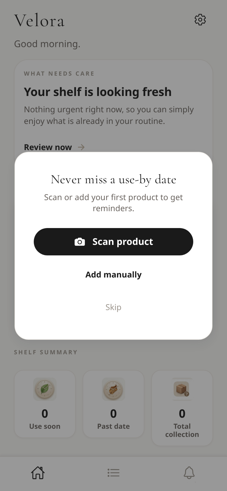
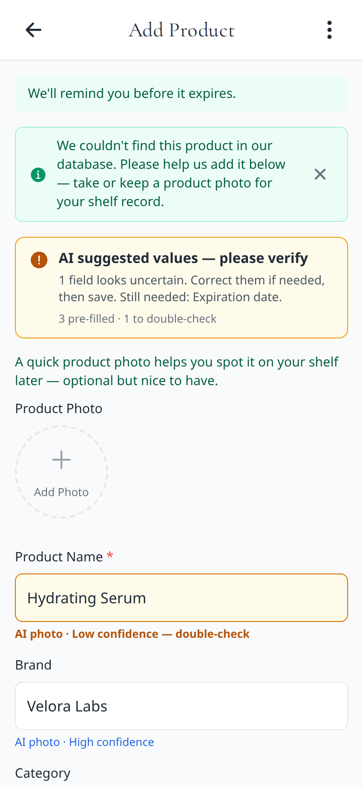
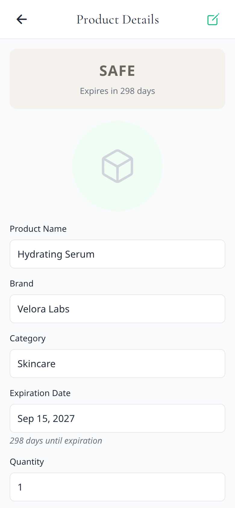

# Velora

**Beauty shelf tracker with honest AI intake.**  
Scan a barcode or label photo → review suggested fields (with confidence) → save → get expiry reminders.

Built with React Native / Expo. Suitable as a portfolio case study for AI-assisted product workflows (human review before save — not silent autopilot).

<p align="center">
  
  &nbsp;
  
  &nbsp;
  
</p>

<p align="center"><sub>
<strong>Home</strong> · shelf status at a glance &nbsp;|&nbsp;
<strong>Review</strong> · AI suggestions with confidence &nbsp;|&nbsp;
<strong>Detail</strong> · saved item + expiry status
</sub></p>

## What it is (10 seconds)

| | |
|---|---|
| **Problem** | Beauty products expire; people lose track of open dates and batch expiry. |
| **Product** | Mobile inventory for skincare / makeup / fragrance with reminders. |
| **AI role** | Optional label-photo extraction and barcode lookup that **pre-fill** a form — the user confirms uncertain fields before save. |
| **Not** | Skin diagnosis, medical advice, or a production SaaS claim with user metrics. |

## Product screens

| Screen | What you see |
|--------|----------------|
| **Home** | Care summary, add CTA, shelf counts (use soon / past date / total). |
| **Add Product (review)** | Prefill from scan/AI, review banner, High / Medium / Low confidence tags, amber “double-check” fields, validation before save. |
| **Product Detail** | Saved record with SAFE / expiring / expired status and countdown. |

Screenshots above were captured from the Expo **web** target in development (camera unavailable on web; AI review shown via a marked fixture path — see [`docs/WORKSHOP_DEMO.md`](docs/WORKSHOP_DEMO.md)).

## Core flow

```text
Barcode lookup  ─┐
                 ├─→  Add Product (review / correct)  →  Save  →  Detail + reminders
AI label photo  ─┘
Manual entry    ─┘
```

- **Barcode** → Supabase Edge Function `lookup-product` (cache / Open Food Facts / demo catalog)
- **AI photo** → Edge Function `analyze-product-image` (Gemini server-side; no model key in the client)
- **Review** → confidence labels, missing critical fields called out, user edits before save
- **Storage** → guest: AsyncStorage; signed-in: optional Supabase `products`

## Tech stack

- React Native + Expo SDK 54 · TypeScript · React Navigation
- Supabase (Edge Functions + optional Postgres)
- NativeWind / Tailwind
- Local notifications for expiry reminders (native; skipped on web)

## Getting started

**Requirements:** Node.js 20.19+ (or newer LTS), npm. Expo Go for physical devices.

```bash
git clone https://github.com/Charleschtsoi/velora-beauty-tracker.git
cd velora-beauty-tracker
npm install
```

Configure `.env.local` (see `.env.example` / [`ENV_SETUP.md`](ENV_SETUP.md)):

```bash
EXPO_PUBLIC_SUPABASE_URL=your_supabase_url
EXPO_PUBLIC_SUPABASE_ANON_KEY=your_supabase_anon_key
```

Gemini lives only as an Edge Function secret (`GEMINI_API_KEY`) — never in the client.

```bash
npm start          # Expo (runs a small connection diagnostic first)
npm run web        # Browser (best for headless / cloud VMs)
npm run ios        # iOS simulator
npm run android    # Android emulator
npm test           # Focused unit tests (validation, confidence, error copy)
```

## Workshop / portfolio notes

- Reproducible demo + limitations: [`docs/WORKSHOP_DEMO.md`](docs/WORKSHOP_DEMO.md)
- Short factual summary: [`docs/PORTFOLIO_SUMMARY.md`](docs/PORTFOLIO_SUMMARY.md)
- `DEMO_MODE` in `src/config/demoMode.ts` — `false` = real review path (default); `true` = curated catalog auto-add for investor walkthroughs

## Project structure

```text
src/
  screens/          # Home, Scan, Add Product, Detail, Inventory, …
  services/         # AI, barcode lookup, products, auth, notifications
  utils/            # Confidence, validation, user-facing errors (tested)
  config/           # demoMode, demoProducts, supabase
supabase/
  functions/        # analyze-product-image, lookup-product, …
  migrations/
docs/
  screenshots/      # README product screens
```

## Troubleshooting

**Expo package warnings** — run `npx expo install expo expo-file-system expo-image-picker expo-notifications`, then restart Metro.

**Tunnel (`remote gone away`)** — retry `npx expo start --tunnel`, check [ngrok status](https://status.ngrok.com/), or use LAN (`npm start`) on the same Wi‑Fi.

**Camera** — grant OS permission, or use Manual entry / (in `__DEV__`) the fixture review link on Scan.

## License

Private project. All rights reserved.
